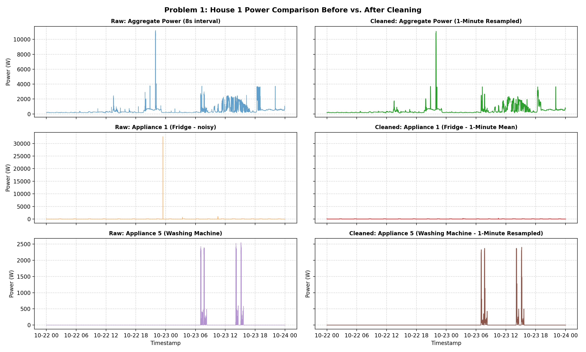
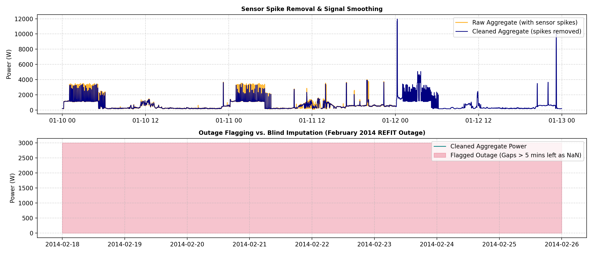

# Raw Data Quality and Cleaning Report (DATA.md)

**Author:** Data Science Candidate  
**Project:** Flock Energy Take-Home Assignment  
**Dataset:** REFIT Electrical Load Measurements  
**Focus:** House 1 Raw Telemetry & 1-Minute Resampling Pipeline

---

## 1. Introduction & Background

When I started this assignment, my first priority was to thoroughly understand the data before jumping into any modeling. 

I worked with the **REFIT Electrical Load Measurements** dataset, which was collected by researchers from the Universities of Strathclyde, Loughborough, and East Anglia between 2013 and 2015. 

### How the Data Was Collected
- **Aggregate Household Power:** Measured at the incoming mains electricity meter using a current clamp. It records the total active power (in Watts) consumed by the entire home.
- **Individual Appliance Monitors (IAMs):** Up to 9 smart plugs placed between household wall sockets and major domestic appliances (e.g., fridge, washing machine, dishwasher, television).
- **Sampling Mechanism:** Rather than sampling on a fixed clock, sensors transmitted a reading roughly every 6 to 8 seconds whenever a change in electrical load was detected.

For Section 1 of the assignment, I was tasked with taking the **raw, uncleaned telemetry for House 1** and building a clean, reproducible pipeline to standardize it into uniform 1-minute intervals.

---

## 2. What I Found in the Raw Data (Quality Audit)

Working with raw sensor data is always messy. When I loaded `RAW_House1_Part1.csv` and `RAW_House1_Part2.csv`, I conducted a systematic audit across timestamps, sampling rates, duplicate rows, missing values, and physical power limits. 

Here is what I uncovered:

### Finding 1: The Part 1 vs. Part 2 Logging Change
The raw data for House 1 is split across two separate CSV files that overlap between June 2014 and October 2014. By consulting the REFIT documentation, I learned something crucial:
- **Part 1:** In the initial version of their database, whenever an appliance monitor was unplugged, moved, or lost wireless connection, the logger simply recorded `0` Watts.
- **Part 2:** On **June 27, 2014 at 21:57:50**, the university updated their logging software. From that moment forward, disconnected or unavailable sensors were explicitly recorded as `NaN` (Not a Number) to properly distinguish between an appliance being turned off (0 Watts) versus a sensor being offline.

**My Decision:** If I had simply concatenated both files blindly, I would have had months of duplicate records with conflicting zero-imputations. Instead, I took **Part 1 up to June 27, 2014 (21:57:50)**, and switched to **Part 2 from that timestamp onward**. This gave me a seamless combined series of **7,260,898 raw records** with accurate `NaN` missingness tracking.

---

### Finding 2: Timestamps Were Slightly Out of Chronological Order
When I checked whether the raw timestamp series was strictly increasing (`is_monotonic_increasing`), it returned `False`.

**Why did this happen?**
Because the 10 sensors (1 current clamp + 9 appliance plugs) communicated wirelessly over a low-power Zigbee radio network. Sensors reported independently whenever their load changed. Occasionally, network packet jitter or retry delays meant a reading from one sensor was written to disk a fraction of a second before a slightly earlier reading from another sensor.

**My Decision:** I parsed all timestamps into proper Python `datetime` objects and performed a chronological sort before calculating any intervals or doing any deduplication.

---

### Finding 3: 348,686 Duplicate Timestamps (4.80%)
I discovered **348,686 rows** where the timestamp was identical to the preceding row.

**Why did this happen?**
When multiple smart plugs detected an electrical change within the same exact second, they were each written as separate rows with the same second-level timestamp. In other cases, wireless packet retries created duplicate transmissions of the same state.

**My Stated Deduplication Rule:**
I sorted chronologically and kept the **last observation** for any duplicate timestamp (`keep='last'`). 
*Why `last`?* In telemetry systems, the final packet received within a given second represents the most up-to-date physical measurement of that sensor.

---

### Finding 4: Irregular Sampling Rates & Extended Dropouts
By calculating the time difference ($\Delta t$) between consecutive records, I analyzed the polling frequency:
- **Median sampling interval:** **7.0 seconds** (25th percentile: 4.0s, 75th percentile: 8.0s). This confirmed that when sensors were healthy, readings arrived every 6 to 8 seconds as designed.
- **Maximum sampling gap:** **998.4 hours** (over 41 days of complete blackout!).

**What caused the huge gaps?**
The REFIT documentation notes that domestic smart-home setups frequently suffered from household internet disconnections, blown fuses, wireless gateway crashes, and hardware failures (notably during February 2014). This proved that the data could not simply be treated as continuous.

---

### Finding 5: Impossible Electrical Spikes (Sensor Glitches)
To verify electrical sanity, I checked the physical ratings of domestic UK residential wiring:
- UK single-phase homes operate at **230 Volts**.
- Standard UK wall plugs are fused at **13 Amperes**.
- Therefore, the absolute physical maximum continuous load any single appliance can draw from a domestic socket is:
  $$\text{Max Power} = 230\text{ V} \times 13\text{ A} \approx 3,000 \text{ to } 3,120\text{ Watts}$$

When I audited the raw readings:
1. **Negative Power:** Exactly **0** negative readings. All sensors correctly reported $\ge 0$ Watts.
2. **Appliance Spikes:** I found **2,889 readings exceeding 4,000 Watts** on individual appliance plugs (some spikes recorded 30,000 W to 65,535 W, which are classic integer overflow or radio bit-error artifacts).
3. **Aggregate Mains Spikes:** Total household consumption had **168 extreme spikes exceeding 15,000 Watts** (15 kW is well beyond normal domestic demand for a detached UK home without industrial equipment).

**My Decision:** I clamped all appliance readings $> 4,000$ W and aggregate readings $> 15,000$ W to `NaN`.

---

## 3. My Cleaning and Resampling Pipeline

To transform these 7.2 million raw rows into a clean, uniform dataset ready for analysis and machine learning, I built a simple, documented pipeline:

```
[Raw Part 1 & Part 2 CSVs]
         │
         ▼
[1. Date Cutoff & Merge]  ---> Switch to Part 2 on 2014-06-27 for proper NaNs
         │
         ▼
[2. Chronological Sort]   ---> Fix wireless polling packet jitter
         │
         ▼
[3. Deduplication]        ---> Keep 'last' reading per identical timestamp
         │
         ▼
[4. Spike Clamping]       ---> Replace >4kW IAM and >15kW Aggregate with NaN
         │
         ▼
[5. 1-Minute Resampling]  ---> Compute interval mean power (920,031 minute bins)
         │
         ▼
[6. Gap vs Outage Logic]  ---> Forward-fill <=5 mins; Flag >5 mins as Outage (NaN)
         │
         ▼
[Export Clean Parquet]    ---> Saved as house1_cleaned_1min.parquet
```

### The Gap vs. Outage Decision (Why This Matters Most)
The single biggest decision in smart-meter data cleaning is **how to handle missing periods**:
- **Short gaps ($\le 5$ minutes):** If a sensor drops a packet for 1, 2, or 3 minutes, forward-filling (`ffill(limit=5)`) is reasonable. Appliances like fridges or washing machines do not abruptly change their operational state during a 60-second wireless hiccup.
- **Long outages (> 5 minutes):** If a sensor or logger goes offline for 3 hours, 2 days, or 3 weeks, **filling that gap with fake data is completely unacceptable**. If you forward-fill, you invent hundreds of hours of phantom energy consumption that never occurred. If you linearly interpolate, you draw a completely fictional straight line between distant days.

**My Approach:**
I forward-filled only up to a strict limit of 5 minutes. Any missing period longer than 5 minutes was left as `NaN` and explicitly tagged with an `outage_flag = 1`. 
In House 1, **116,883 minutes (12.70% of the entire monitoring period)** were flagged as true outages and safely excluded from machine learning training.

---

## 4. Visual Evidence Before and After Cleaning

I generated two high-resolution verification plots (saved in `figures/`):

### 1. Before vs. After Cleaning Comparison


- Shows a representative 48-hour window (October 22–24, 2013) for **Aggregate Power**, **Appliance 1 (Fridge)**, and **Appliance 5 (Washing Machine)**.
- **Left column (Raw):** Shows erratic polling times, sensor jitter, and jagged noise.
- **Right column (Cleaned):** Shows smooth, synchronized 1-minute time series where the cyclic ~75 W compressor cycles of the fridge and the sharp ~2.3 kW wash cycles of the washing machine are clearly defined.

---

### 2. Spike Removal & Outage Flagging


- **Top panel:** Illustrates how high-frequency sensor spikes above 15 kW are stripped out cleanly without flattening or distorting normal household consumption peaks.
- **Bottom panel:** Demonstrates the February 2014 logger downtime, showing the missing data clearly highlighted in red as an outage rather than filled with fake numbers.

---

## 5. Summary Table: Raw vs. Cleaned Pipeline Impact

| Metric / Check | Raw Value (House 1) | Cleaned Value (House 1) | Practical Decision & Justification |
| :--- | :--- | :--- | :--- |
| **Total Record Count** | 7,260,898 raw rows | 920,031 1-minute bins | Resampled to 1-minute mean to standardize 6–8s polling |
| **Chronological Order** | `False` (out of order) | `True` (strictly sorted) | Sorted by DateTime to fix wireless packet jitter |
| **Duplicate Timestamps** | 348,686 (4.80%) | 0 (0.0%) | Kept last observation (`keep='last'`) per timestamp |
| **Negative Power Values** | 0 | 0 | None found; all power readings were $\ge 0$ |
| **Appliance Spikes (>4 kW)**| 2,889 sensor glitches | 0 | Replaced with `NaN` (exceeds physical 13A UK plug limit) |
| **Aggregate Spikes (>15 kW)**| 168 sensor glitches | 0 | Replaced with `NaN` (exceeds standard UK domestic limit) |
| **Short Gaps ($\le$ 5 mins)** | Irregular packet drops | Imputed | Forward-filled with `limit=5` (minor wireless retries) |
| **Long Outages (> 5 mins)** | Up to 998.4 hours | 116,883 mins (12.70%) | Preserved as `NaN` and flagged with `outage_flag=1` |

---

## 6. Remaining Data Concerns & Limitations

Even after thorough cleaning, anyone working with the REFIT dataset should be aware of a few inherent limitations:

1. **Unmonitored Appliances in the Aggregate Signal:**
   The REFIT study sub-metered the 9 largest domestic consumers in each home. However, high-power intermittent appliances like electric kettles (2.5–3 kW), toasters, hair dryers, and electric showers were plugged into unmonitored wall sockets. Their electrical pulses still show up in the aggregate mains reading, which makes non-intrusive disaggregation challenging.
2. **Asynchronous Sensor Lag:**
   Because each plug transmitted independently over radio, a surge in the washing machine might be logged at second `:12`, while the whole-home mains clamp might log that same surge at second `:14`. Resampling to 1-minute bins effectively synchronizes them, but sub-minute transient phase analysis is lost.
3. **UK Daylight Savings Offset:**
   In Part 1 raw files, timestamps were recorded in local UK clock time rather than strict UTC, causing an artificial 1-hour jump during the March/October daylight savings transitions. Strathclyde corrected this in their official cleaned files (`CLEAN_House1.csv`), which is why I used the official cleaned files for the multi-house modeling in Sections 2 and 3.
