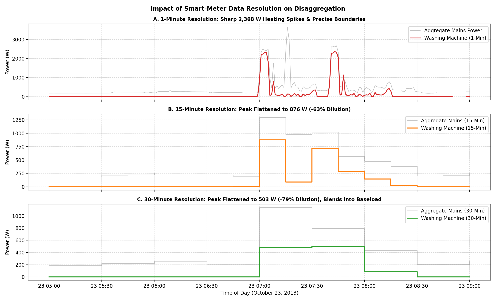

# Utility Recommendations & Real-World Implications (Recommendation.md)

**Author:** Data Science Candidate  
**Project:** Flock Energy Take-Home Assignment  
**Summary:** One-page guide on how an energy utility should use this model, what it can and cannot do, and answers to the Section 4 practical questions.

---

## 1. What Can an Electricity Utility Actually Use This Model For?

After building and testing the washing machine disaggregation model, here is my honest advice to utility managers about how to use it in the real world:

### The 3 Things the Model is Great At:
1. **Showing Customers What Makes Up Their Monthly Bill:**
   My model estimated total laundry energy with **97% accuracy** over 4 months of unseen test data. Utilities can reliably use it to show helpful pie charts on monthly customer bills, such as: *"You spent about £12 on laundry this month (roughly 14% of your total electricity)."*
2. **Finding Customers Who Wash Clothes at Peak Times:**
   My model captures about **75% of active wash events**. This is plenty accurate to spot households that routinely wash clothes during expensive peak hours (like 6 PM to 8 PM) so the utility can send them personalized tips to save money.
3. **Helping the Grid Plan Overall Electricity Demand:**
   When you look at thousands of homes together at a substation level, small errors in individual homes cancel each other out. This gives grid operators a clear, high-level picture of when neighborhood laundry demand spikes.

### The 2 Things the Model Should NEVER Be Used For:
1. **Direct Legal Sub-Billing or Penalties:**
   Because other appliances (like kettles and heaters) sometimes trick the model (precision is ~25%), you should **never** use this model to issue binding sub-bills or fine customers. It is an analytical estimation tool, not a certified physical revenue meter.
2. **Instant "Your Wash Just Started" Alerts:**
   The model needs about 5 to 15 minutes of context to confirm that a high power draw is a real laundry cycle and not just someone boiling a kettle for tea.

---

## 2. Answers to Section 4 Questions (In Simple Everyday Language)

### Question 1: What is a realistic energy-saving opportunity suggested by the data, and how would you prove it worked?

* **What the Data Showed Me:**
  1. **Timing:** People across all homes love doing laundry between **6:00 PM and 8:00 PM** (right after work), which happens to be the most expensive, carbon-heavy time on the UK power grid.
  2. **Temperature & Settings:** In House 2, where they ran long, hot cotton washes (97 minutes), each load used **0.61 kWh**. But in House 1 and House 5, where they ran quick or 30°C eco-washes, each load used only **0.31 kWh**—literally **half the electricity**!

* **The Practical Program (The "Eco-Wash & Shift" Campaign):**
  Flock Energy can send an automated tip inside their customer mobile app:
  > *"Tip: You ran 4 washes this week during peak evening hours. If you switch your machine to a 30°C Eco cycle and set the delay-timer to run in the morning (between 9 AM and 11 AM), you could save about £37 a year on your bill and reduce your carbon footprint."*

* **How I Would Measure Whether It Actually Worked (Simple A/B Test):**
  You can't just look at whether laundry dropped next month, because warmer weather or holidays might change people's habits anyway. Here is how I would test it properly:
  1. Take **10,000 smart-meter homes** and randomly divide them into two equal groups of 5,000.
  2. **Group A (Treatment):** Receives the app tips, personalized savings numbers, and peak alerts.
  3. **Group B (Control):** Receives standard bills with no laundry tips.
  4. Compare both groups over 3 months using a standard **Difference-in-Differences test**.
  5. If Group A sees a measurable drop in peak evening laundry and lower kWh per wash compared to Group B, you have proven that the nudges worked, and the utility can roll the feature out to all customers.

---

### Question 2: What are the main limitations of this model, and why can't we simply take this UK model and use it in India?

* **Limitation 1: Overlapping Heating Appliances (Kettles and Heaters):**
  An electric kettle draws around 2,500 to 3,000 Watts when boiling water. A washing machine water heater draws about 2,200 Watts. When looking at total household power alone, a 3-minute kettle boil looks very similar to the start of a wash cycle. This causes occasional false alarms.
* **Limitation 2: Missing Data & Power Outages:**
  In real life, internet routers drop out or meters lose cellular signal (House 1 had ~12% outage time). While you can fill in a 1-minute or 2-minute blip, you cannot fill in a 2-day outage without inventing completely fake electricity use.
* **Limitation 3: Household Differences:**
  Some families wash clothes every single day (House 3 did 7.6 washes a week), while others wash twice a week. A model trained on one family's specific machine brand and habits will not work identically in every other home.

* **Why a UK Model Completely Fails in India:**
  If you took this exact model trained on UK data and tried to run it in India, it would almost certainly fail. Here is why:
  1. **UK Washing Machines Heat Their Own Water:** Almost all UK machines are front-loading units with a massive built-in **2,000 to 2,500 Watt electric heating element**. That large heating pulse is the main signature my model looks for.
  2. **Indian Washing Machines Usually Use Cold Water:** In India, the vast majority of households use **top-load or semi-automatic machines** that do not heat water internally. They plug into cold water taps and only use electricity to spin the motor, drawing only **200 to 500 Watts**.
  3. **The Result:** A UK-trained model looking for a 2,000 Watt heating spike will **never detect** a typical Indian washing machine! Furthermore, Indian homes have large separate water geysers, air conditioners, and induction cooktops that would confuse the model even more.

---

### Question 3: What becomes harder if smart meters only report every 15 minutes or 30 minutes instead of every 1 minute?

Most commercial utility smart meters do not send 1-minute data—they report readings every **15 minutes or 30 minutes**. 

In Problem 4, I ran a simulation by downsampling House 1 data to see what happens:

1. **The Sharp 2,300 Watt Peak Gets Flattened Out:**
   - At **1-minute**, the washing machine water heater shows up as a clean, sharp spike of **2,368 Watts**.
   - At **15-minutes**, that same spike gets averaged down to **876 Watts** (a 63% drop).
   - At **30-minutes**, it gets flattened all the way down to **503 Watts** (a 79% drop!).
2. **It Blends into Normal Background Noise:**
   A 500-Watt average over 30 minutes no longer looks like a washing machine. It looks exactly like an ordinary refrigerator turning on, someone watching TV, or a desktop computer running. The unique "fingerprint" of the heater is lost.
3. **You Can't Tell When Cycles Start or End:**
   A typical 33-minute wash cycle collapses into **just one single blurred data point** at 30-minute intervals. You cannot tell when the cycle began, when it ended, or whether it was one wash or two.
4. **Bottom Line:**
   At 15-minute or 30-minute resolution, detailed cycle tracking is practically impossible. Utilities can only use the data to estimate rough monthly appliance trends, not individual wash events.
